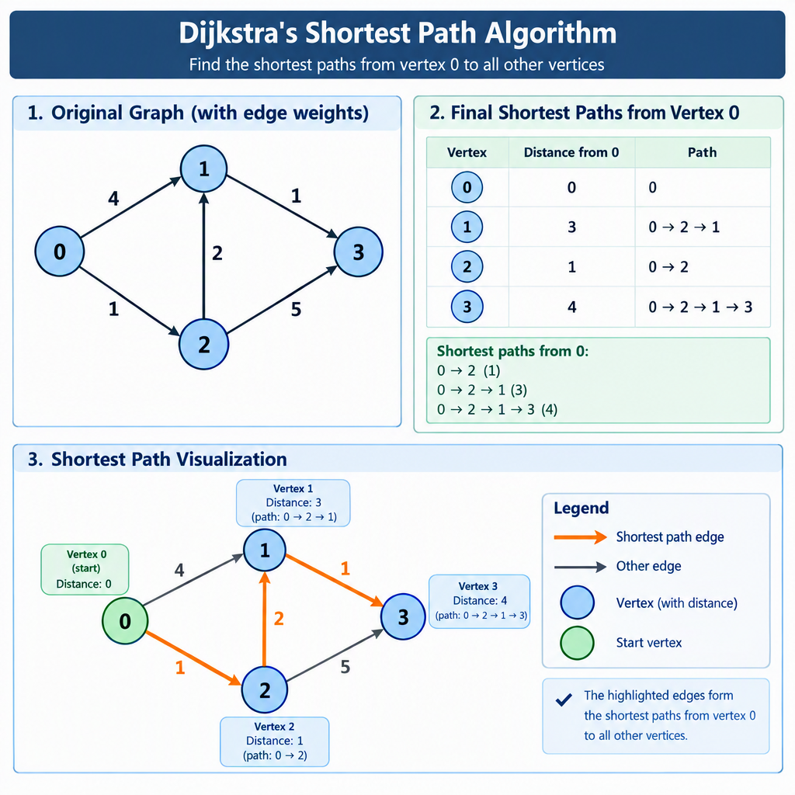
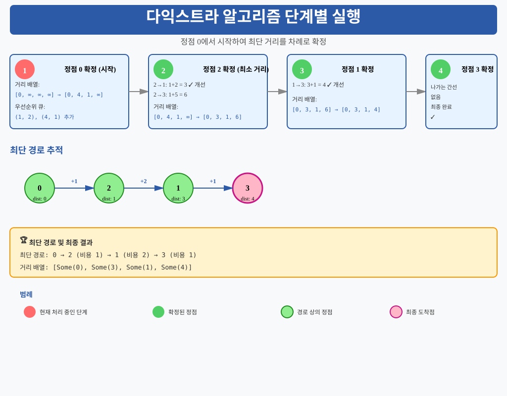
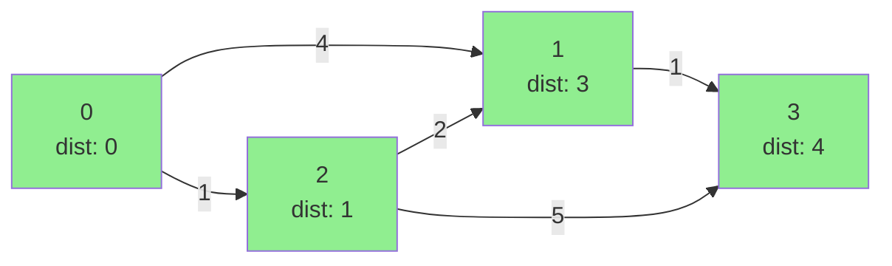

# 다익스트라 최단 경로

다익스트라 알고리즘은 하나의 시작 정점에서 모든 정점까지의 최단 거리를 구한다. 간선 가중치는 음수가 아니어야 한다. 가장 작은 현재 거리를 가진 미확정 정점을 선택하고, 그 정점에서 나가는 간선을 완화(relax)하는 과정을 반복한다. 우선순위 큐를 사용하면 일반적인 희소 그래프에서 효율적이다.

## 알고리즘 원리

1. **초기화**: 시작 정점의 거리를 0, 나머지를 무한대로 설정
2. **반복**: 가장 작은 거리의 미확정 정점을 선택해 "확정"
3. **완화(Relax)**: 확정 정점에서 인접한 모든 정점의 거리를 갱신
4. **종료**: 모든 정점이 확정되거나 큐가 비워질 때까지 반복

**핵심 성질**: 음이 아닌 가중치에서는 한 번 확정한 거리가 더 이상 감소하지 않는다.

## 동작 다이어그램


그림에서는 A에서 B와 C를 완화한 뒤 더 작은 거리 1의 C를 확정하고, C를 통해 D를 거리 3으로 갱신합니다. 모든 간선 가중치가 음이 아니므로 확정한 거리는 다시 줄어들지 않습니다. 아래 Rust 코드와 테스트는 이 그림과 다른 그래프를 사용합니다.

### 그림 단계별 읽기

- 그림의 방향 간선과 가중치는 A→B `4`, A→C `1`, B→D `1`, C→D `2`입니다.
- A를 확정하면 임시 거리가 B=`4`, C=`1`이 되고, 더 작은 C를 다음에 확정합니다.
- C→D를 완화해 D를 `1 + 2 = 3`으로 갱신하며, B→D 후보 `4 + 1 = 5`보다 작아 최종 결과는 `[0, 4, 1, 3]`입니다.
- 그림의 모든 가중치는 음수가 아니고 음수 사이클도 표시되지 않습니다. 이 비음수 전제가 깨지면 확정 거리의 불변식이 성립하지 않아 다익스트라를 사용할 수 없습니다.

### Rust 예제의 단계별 실행

위 그림은 설명용 A–D 그래프이고, 아래 첫 Rust 예제의 실제 그래프는 정점 번호 `0..=3`과 다음 방향 간선을 사용합니다.


- 시작 시 `distance = [Some(0), None, None, None]`이고 `BinaryHeap`에는 `Reverse((0, 0))`만 들어갑니다. 정점 `0`을 꺼내 `0→1`의 후보 `4`, `0→2`의 후보 `1`을 기록하면 우선순위 큐에는 `(1, 2)`와 `(4, 1)`이 남습니다.
- `Reverse((1, 2))`가 먼저 나오므로 정점 `2`를 처리합니다. `2→1`에서 `1 + 2 = 3`을 얻어 기존 `4`를 개선하고 `(3, 1)`을 새로 넣습니다. `2→3`에서는 `1 + 5 = 6`이므로 `(6, 3)`도 넣습니다. 이 구현은 기존 `(4, 1)`을 힙에서 삭제하지 않고 새 후보를 추가합니다.
- 다음은 `(3, 1)`입니다. `1→3`을 완화해 `3 + 1 = 4`를 기록하므로 현재 거리는 `[Some(0), Some(3), Some(1), Some(4)]`가 됩니다.
- 이때 거리 `4`인 `(4, 1)`과 `(4, 3)`이 동률입니다. `Reverse((거리, 정점))`는 tuple 전체를 뒤집으므로 거리 우선, 거리도 같으면 정점 번호가 작은 항목을 먼저 꺼냅니다. 따라서 `(4, 1)`이 먼저 나오지만 `distance[1]`은 이미 `Some(3)`이므로 오래된 후보로 **간선을 완화하지 않고 건너뜁니다**. 이어 `(4, 3)`을 꺼내면 나가는 간선이 없습니다.
- 마지막으로 큐에 남은 `Reverse((6, 3))`은 오래된 후보입니다. `distance[3]`이 이미 `Some(4)`인데 꺼낸 `cost`가 `6`이므로 `distance[vertex] != Some(cost)`가 참이 되어 `continue`로 건너뜁니다. 오래된 항목의 간선을 다시 완화하지 않으므로 최종 결과는 `[Some(0), Some(3), Some(1), Some(4)]`입니다.
- SVG의 `heap` 표기는 구현 내부 배열 순서가 아니라, 다음에 꺼내질 우선순위 순서로 읽어야 합니다. 모든 간선 가중치는 음수가 아니므로 확정한 거리는 이후 더 작아지지 않습니다.


이 문서의 구현은 `u64` 가중치와 거리를 사용한다. `checked_add`로 거리 덧셈의 오버플로를 검사하며, 오버플로하는 후보는 최단 거리 후보로 사용하지 않는다. 따라서 결과의 `None`은 도달 불가능하거나 최단 거리를 `u64`로 표현할 수 없음을 뜻한다. 모든 간선의 정점 번호는 유효해야 한다. 외부 입력을 `u64`로 변환하기 전에는 음수 여부도 검증해야 한다. 음수 간선에는 다익스트라를 사용할 수 없고, 필요하면 벨만-포드 같은 알고리즘을 사용해야 한다.

정점 수를 `V`, 간선 수를 `E`라고 할 때 이 구현은 힙에 같은 정점의 오래된 후보를 여러 개 넣을 수 있다. 일반적인 다중 그래프에서 시간은 `O(V + (E + 1) log(E + 1))`, 추가 공간은 `O(V + E)`이며, 단순 그래프에서는 흔히 `O((V + E) log V)`로 표현한다. 꺼낸 거리가 현재 거리와 다르면 오래된 후보이므로 건너뛴다.

## 그래프 시각화

다음은 본 문서의 Rust 예제에서 사용하는 그래프입니다:

```
graph = vec![vec![(1, 4), (2, 1)], vec![(3, 1)], vec![(1, 2), (3, 5)], vec![]];
```

### 📊 다익스트라 최단경로 다이어그램



위 다이어그램은 다음을 보여줍니다:

- **왼쪽**: 원본 그래프의 모든 간선과 가중치
- **중간**: 각 정점의 최단 거리 테이블 및 최단 경로
- **오른쪽**: 정점 0에서 시작하는 최단 경로들 (오렌지색 화살표로 표시)

**최단 경로 결과**:
- 정점 1: 거리 3 (경로: 0 → 2 → 1)
- 정점 2: 거리 1 (경로: 0 → 2)
- 정점 3: 거리 4 (경로: 0 → 2 → 1 → 3)

### 🎯 인터랙티브 시각화 보기

**[→ 다익스트라 알고리즘 단계별 실행 과정 (HTML 버전)](/docs/dijkstra-visual)**

위 링크를 클릭하면 Mermaid 다이어그램이 도형으로 렌더링된 완전한 시각화 페이지를 볼 수 있습니다.

### 알고리즘 실행 단계별 시각화



이 다이어그램은 정점 0에서 시작하여 각 단계별로 최단 경로를 확정하고 거리를 갱신하는 과정을 보여줍니다:

1. **정점 0 확정 (거리: 0)**
   - 초기: 1번 경로 거리 4, 2번 경로 거리 1
   
2. **정점 2 확정 (거리: 1) - 최소 거리**
   - 2→1: 거리 1 + 2 = 3 (기존 4 개선)
   - 2→3: 거리 1 + 5 = 6
   
3. **정점 1 확정 (거리: 3)**
   - 1→3: 거리 3 + 1 = 4 (기존 6 개선)
   
4. **정점 3 확정 (거리: 4)**
   - 나가는 간선 없음, 종료

### Mermaid 다이어그램



**다익스트라 실행 순서**:

| 단계 | 확정 정점 | 거리 | 처리 내용 | 갱신된 거리 |
|------|---------|------|---------|-----------|
| 1 | 0 | 0 | 0→1 (거리 4), 0→2 (거리 1) | dist[1]=4, dist[2]=1 |
| 2 | 2 | 1 | 2→1 (거리 1+2=3 ✓ 개선), 2→3 (거리 1+5=6) | dist[1]=3, dist[3]=6 |
| 3 | 1 | 3 | 1→3 (거리 3+1=4 ✓ 개선) | dist[3]=4 |
| 4 | 3 | 4 | 나가는 간선 없음 | 완료 |

**최종 결과**: `[Some(0), Some(3), Some(1), Some(4)]`

**최단 경로**: 0 → 2 (비용 1) → 1 (비용 2) → 3 (비용 1) = **총 비용 4**

## 실행 가능한 Rust 예제

```rust
use std::cmp::Reverse;
use std::collections::BinaryHeap;

fn dijkstra(graph: &[Vec<(usize, u64)>], start: usize) -> Vec<Option<u64>> {
    let mut distance = vec![None; graph.len()];
    if start >= graph.len() {
        return distance;
    }

    let mut heap = BinaryHeap::new();
    distance[start] = Some(0);
    heap.push(Reverse((0_u64, start)));

    while let Some(Reverse((cost, vertex))) = heap.pop() {
        if distance[vertex] != Some(cost) {
            continue;
        }
        for &(next, weight) in &graph[vertex] {
            let Some(candidate) = cost.checked_add(weight) else {
                continue; // u64 오버플로 후보는 무시한다.
            };
            if distance[next].map_or(true, |old| candidate < old) {
                distance[next] = Some(candidate);
                heap.push(Reverse((candidate, next)));
            }
        }
    }
    distance
}

fn main() {
    let graph = vec![vec![(1, 4), (2, 1)], vec![(3, 1)], vec![(1, 2), (3, 5)], vec![]];
    println!("{:?}", dijkstra(&graph, 0));
}

#[cfg(test)]
mod tests {
    use super::dijkstra;

    #[test]
    fn finds_shortest_paths_and_unreachable_vertices() {
        let graph = vec![vec![(1, 4), (2, 1)], vec![(3, 1)], vec![(1, 2)], vec![], vec![]];
        assert_eq!(dijkstra(&graph, 0), vec![Some(0), Some(3), Some(1), Some(4), None]);
    }

    #[test]
    fn traces_the_documented_binary_heap_example() {
        use std::{cmp::Reverse, collections::BinaryHeap};
        let graph: Vec<Vec<(usize, u64)>> = vec![vec![(1, 4), (2, 1)], vec![(3, 1)], vec![(1, 2), (3, 5)], vec![]];
        let mut distance = vec![None; graph.len()];
        let mut heap = BinaryHeap::new();
        distance[0] = Some(0);
        heap.push(Reverse((0_u64, 0_usize)));
        let mut trace = Vec::new();
        while let Some(Reverse((cost, vertex))) = heap.pop() {
            let stale = distance[vertex] != Some(cost);
            if !stale {
                for &(next, weight) in &graph[vertex] {
                    if let Some(candidate) = cost.checked_add(weight) {
                        if distance[next].map_or(true, |old| candidate < old) {
                            distance[next] = Some(candidate);
                            heap.push(Reverse((candidate, next)));
                        }
                    }
                }
            }
            let mut queue = heap.iter().map(|item| item.0).collect::<Vec<_>>();
            queue.sort_unstable(); // 표시용 우선순위 순서이며 힙 내부 배열 순서가 아니다.
            trace.push((cost, vertex, stale, distance.clone(), queue));
        }
        assert_eq!(trace, vec![
            (0, 0, false, vec![Some(0), Some(4), Some(1), None], vec![(1, 2), (4, 1)]),
            (1, 2, false, vec![Some(0), Some(3), Some(1), Some(6)], vec![(3, 1), (4, 1), (6, 3)]),
            (3, 1, false, vec![Some(0), Some(3), Some(1), Some(4)], vec![(4, 1), (4, 3), (6, 3)]),
            (4, 1, true, vec![Some(0), Some(3), Some(1), Some(4)], vec![(4, 3), (6, 3)]),
            (4, 3, false, vec![Some(0), Some(3), Some(1), Some(4)], vec![(6, 3)]),
            (6, 3, true, vec![Some(0), Some(3), Some(1), Some(4)], vec![]),
        ]);
        assert_eq!(dijkstra(&graph, 0), distance);
    }

    #[test]
    fn handles_zero_weight_edges_and_invalid_start() {
        let graph = vec![vec![(1, 0)], vec![(2, 0)], vec![]];
        assert_eq!(dijkstra(&graph, 0), vec![Some(0), Some(0), Some(0)]);
        assert_eq!(dijkstra(&graph, 9), vec![None, None, None]);
    }

    #[test]
    fn ignores_overflowing_candidate() {
        let graph = vec![vec![(1, u64::MAX)], vec![(2, 1)], vec![]];
        assert_eq!(dijkstra(&graph, 0), vec![Some(0), Some(u64::MAX), None]);
    }
}
```

PowerShell에서 파일을 `dijkstra_example.rs`로 저장한 뒤 다음처럼 실행할 수 있다. 이 코드는 안정 Rust의 `map_or`와 `checked_add`를 사용한다.

```powershell
rustc --test dijkstra_example.rs -o dijkstra_example_tests.exe; .\dijkstra_example_tests.exe
rustc dijkstra_example.rs -o dijkstra_example.exe; .\dijkstra_example.exe
```

## 실무 활용과 선택 기준

다익스트라는 지도 길찾기, 네트워크 라우팅, 게임의 이동 비용처럼 **간선 비용이 음수가 아니고 하나의 출발점에서 여러 목적지까지의 최단 경로가 필요한 상황**에 적합합니다. 경로 자체가 필요하면 각 정점의 이전 정점을 저장하고 목적지에서 시작점까지 역추적합니다. 음수 가중치가 있으면 벨만-포드가 적합하며, 모든 정점 쌍의 결과가 필요하면 플로이드-워셜을 고려합니다. 비가중치 그래프는 BFS가 `O(V + E)`로 더 단순하고, 비음수 가중치에서 목표 하나만 찾을 때는 휴리스틱을 쓸 수 있는 A*가 실용적일 수 있습니다.

| 알고리즘 | 선택 기준 | 시간과 추가 공간 |
| --- | --- | --- |
| BFS | 모든 간선 비용이 같을 때 | `O(V + E)`, `O(V)` |
| 다익스트라 | 음이 아닌 가중치, 단일 출발점 최단 경로 | `O(V + (E + 1) log(E + 1))`, `O(V + E)` |
| 벨만-포드 | 음수 가중치 또는 음수 사이클 검사가 필요할 때 | `O(V + VE)`, `O(V)` |

아래 구현처럼 같은 정점의 후보를 힙에 여러 번 넣는 경우, 다중 그래프에서 시간 복잡도는 `O(V + (E + 1) log(E + 1))`, 추가 공간은 `O(V + E)`입니다. 단순 그래프에서는 흔히 `O((V + E) log V)`로 표현합니다. 전제는 모든 가중치가 음수가 아니고 정점 인덱스가 유효하며, 거리 합이 선택한 정수 타입의 범위에 들어온다는 것입니다. 외부 입력은 알고리즘에 넘기기 전에 검증하고, 오버플로를 무한히 큰 거리로 간주하지 말고 오류로 구분해야 합니다.

## 추가 예제

다음 독립 프로그램은 음이 아닌 `u64` 가중치 그래프에서 목적지까지의 거리와 정점 경로를 함께 복원합니다. 그래프의 모든 간선을 먼저 검사하므로 도달하지 않는 부분의 잘못된 정점도 명시적 오류가 됩니다. 시작점이나 목적지가 잘못된 경우, 거리 덧셈이 `u64` 범위를 넘는 경우, 경로가 없는 경우를 각각 구분합니다. 이 예제는 목적지에 도착한 뒤에도 도달 가능한 간선을 계속 검사하므로, 목적지까지의 거리가 표현 가능해도 다른 경로에서 오버플로가 발생하면 오류를 반환합니다.

```rust
use std::cmp::Reverse;
use std::collections::BinaryHeap;

#[derive(Debug, PartialEq, Eq)]
enum ShortestPathError {
    InvalidVertex(usize),
    Overflow,
}

fn shortest_path(
    graph: &[Vec<(usize, u64)>],
    start: usize,
    goal: usize,
) -> Result<Option<(u64, Vec<usize>)>, ShortestPathError> {
    if start >= graph.len() {
        return Err(ShortestPathError::InvalidVertex(start));
    }
    if goal >= graph.len() {
        return Err(ShortestPathError::InvalidVertex(goal));
    }
    for edges in graph {
        for &(next, _) in edges {
            if next >= graph.len() {
                return Err(ShortestPathError::InvalidVertex(next));
            }
        }
    }

    let mut distance = vec![None; graph.len()];
    let mut previous = vec![None; graph.len()];
    let mut heap = BinaryHeap::new();
    distance[start] = Some(0);
    heap.push(Reverse((0_u64, start)));

    while let Some(Reverse((cost, vertex))) = heap.pop() {
        if distance[vertex] != Some(cost) {
            continue;
        }
        for &(next, weight) in &graph[vertex] {
            let candidate = cost.checked_add(weight).ok_or(ShortestPathError::Overflow)?;
            if distance[next].map_or(true, |old| candidate < old) {
                distance[next] = Some(candidate);
                previous[next] = Some(vertex);
                heap.push(Reverse((candidate, next)));
            }
        }
    }

    let Some(cost) = distance[goal] else {
        return Ok(None);
    };
    let mut path = vec![goal];
    let mut current = goal;
    while current != start {
        current = previous[current].expect("reachable vertex has a predecessor");
        path.push(current);
    }
    path.reverse();
    Ok(Some((cost, path)))
}

fn main() {
    let graph = vec![vec![(1, 4), (2, 1)], vec![(3, 1)], vec![(1, 2), (3, 5)], vec![], vec![]];
    println!("{:?}", shortest_path(&graph, 0, 3));
}

#[cfg(test)]
mod tests {
    use super::{shortest_path, ShortestPathError};

    #[test]
    fn restores_a_nonnegative_weight_path() {
        let graph = vec![vec![(1, 4), (2, 1)], vec![(3, 1)], vec![(1, 2), (3, 5)], vec![], vec![]];
        assert_eq!(shortest_path(&graph, 0, 3), Ok(Some((4, vec![0, 2, 1, 3]))));
    }

    #[test]
    fn reports_unreachable_and_invalid_vertices() {
        let graph = vec![vec![(1, 2)], vec![], vec![]];
        assert_eq!(shortest_path(&graph, 0, 2), Ok(None));
        assert_eq!(shortest_path(&graph, 4, 0), Err(ShortestPathError::InvalidVertex(4)));
        assert_eq!(shortest_path(&[vec![(3, 1)]], 0, 0), Err(ShortestPathError::InvalidVertex(3)));
    }

    #[test]
    fn reports_distance_overflow() {
        let graph = vec![vec![(1, u64::MAX)], vec![(2, 1)], vec![]];
        assert_eq!(shortest_path(&graph, 0, 2), Err(ShortestPathError::Overflow));
    }
}
```

두 예제는 각각 독립 프로그램입니다. 프로젝트 폴더에서 `cargo test`를 실행하면 모든 Rust 코드 블록을 자동으로 추출해 실행과 테스트를 검증합니다.

## 성능 최적화 팁

### 1. 우선순위 큐 선택

**BinaryHeap** (본 구현): 각 정점의 오래된 후보를 여러 개 유지할 수 있습니다. 간단하지만 힙의 크기가 최악 `O(E)`가 될 수 있습니다.

```rust
// BinaryHeap 대신 최소 힙이 필요할 때는 Reverse로 감싼다
use std::cmp::Reverse;
use std::collections::BinaryHeap;

let mut heap: BinaryHeap<Reverse<(u64, usize)>> = BinaryHeap::new();
```

**Fibonacci Heap** (이론적 최적): 각 정점마다 정확히 한 번씩만 추출하므로 시간 복잡도 `O(E + V log V)`를 달성합니다. Rust에서는 직접 구현해야 하고 실무에서는 오버헤드 때문에 중소 그래프에서 느립니다.

**선택 기준**:
- 작은 그래프(V < 1000): BinaryHeap으로 충분
- 중간 그래프(1000 ≤ V < 100000): BinaryHeap 추천
- 매우 큰 그래프(V ≥ 100000): Fibonacci Heap 고려

### 2. 그래프 표현 최적화

**인접 리스트** (본 구현): 소수의 간선만 순회하므로 희소 그래프에 적합합니다.

```rust
// Vec<Vec<(usize, u64)>>: 정점 → [(인접 정점, 가중치)]
let graph: Vec<Vec<(usize, u64)>> = vec![
    vec![(1, 4), (2, 1)],  // 정점 0 → 정점 1(비용 4), 정점 2(비용 1)
    vec![(3, 1)],          // 정점 1 → 정점 3(비용 1)
    vec![(1, 2), (3, 5)],  // 정점 2 → ...
    vec![],                // 정점 3: 나가는 간선 없음
];
```

**인접 행렬**: 모든 간선을 `O(1)`에 조회할 수 있지만 조밀한 그래프에서도 항상 메모리 `O(V²)`를 사용합니다. 간선이 많을 때만 고려합니다.

```rust
// Vec<Vec<Option<u64>>>: distance[i][j] = 정점 i에서 j로의 비용
let distance_matrix: Vec<Vec<Option<u64>>> = vec![
    vec![Some(0), Some(4), Some(1), None],
    vec![None, Some(0), None, Some(1)],
    vec![None, Some(2), Some(0), Some(5)],
    vec![None, None, None, Some(0)],
];
```

### 3. 거리 타입 선택

**정수 타입 (u64)** (본 구현): 빠르고 오버플로를 명시적으로 처리할 수 있습니다.

```rust
// 오버플로 검사
let Some(candidate) = cost.checked_add(weight) else {
    continue; // 오버플로 후보는 무시
};
```

**부동소수점 (f64)**: 연속 가중치가 필요할 때 사용하지만, 비교 오류와 반올림을 고려해야 합니다.

```rust
// 부동소수점 비교는 epsilon으로 처리해야 한다
const EPSILON: f64 = 1e-9;
if candidate < old - EPSILON { // "명확히" 더 작다
    distance[next] = Some(candidate);
}
```

### 4. 조기 종료

목표 정점까지의 거리만 필요하면 그 정점을 확정한 후 중단합니다.

```rust
while let Some(Reverse((cost, vertex))) = heap.pop() {
    if distance[vertex] != Some(cost) {
        continue;
    }
    if vertex == goal {
        return Some(cost); // 조기 종료
    }
    // ... 완화 로직
}
```

## 일반적인 실수와 디버깅 팁

### 1. 오류: "음수 가중치"

**문제**: 음수 가중치가 있으면 다익스트라가 잘못된 거리를 반환합니다.

```rust
// ❌ 잘못된 사용
let graph = vec![vec![(1, -5)], vec![]]; // 음수 가중치!
println!("{:?}", dijkstra(&graph, 0)); // 오류 결과
```

**해결**: 음수 가중치를 감지해 벨만-포드를 사용하거나, 모든 가중치를 조정합니다.

```rust
// ✓ 가중치 음수 검증
for edges in graph {
    for &(_, weight) in edges {
        assert!(weight >= 0, "음수 가중치는 허용 안 함");
    }
}
```

### 2. 오류: "정점 번호 범위"

**문제**: 정점 번호가 그래프 크기를 벗어나면 패닉이 발생합니다.

```rust
// ❌ 잘못된 사용
let graph = vec![vec![(5, 1)], vec![]]; // 정점 5는 없음!
println!("{:?}", dijkstra(&graph, 0)); // 인덱스 범위 초과
```

**해결**: 모든 간선과 시작점을 검증합니다.

```rust
// ✓ 범위 검증
fn validate_graph(graph: &[Vec<(usize, u64)>]) -> Result<(), String> {
    for (u, edges) in graph.iter().enumerate() {
        for &(v, _) in edges {
            if v >= graph.len() {
                return Err(format!("정점 {} → {} 범위 초과", u, v));
            }
        }
    }
    Ok(())
}
```

### 3. 오류: "도달 불가능한 정점"

**문제**: 도달 불가능한 정점의 거리는 `None`입니다. 이를 무한대로 간주하면 안 됩니다.

```rust
// ❌ 잘못된 사용
let result = dijkstra(&graph, 0);
let dist = result[2].unwrap_or(0); // 위험! None을 0으로 처리
```

**해결**: `Option<u64>`을 명시적으로 처리합니다.

```rust
// ✓ 올바른 처리
match result[2] {
    Some(dist) => println!("거리: {}", dist),
    None => println!("도달 불가능"),
}
```

### 4. 오류: "거리 오버플로"

**문제**: 거리 합이 `u64` 범위를 넘으면 패닉이 발생합니다.

```rust
// ❌ 위험한 사용
let distance = cost + weight; // 오버플로 가능!
```

**해결**: `checked_add`를 사용하고 오버플로를 처리합니다.

```rust
// ✓ 안전한 사용
match cost.checked_add(weight) {
    Some(candidate) => { /* 계속 */ },
    None => { /* 오버플로: 최단 경로 후보에서 제외 */ },
}
```

### 5. 디버깅: "오래된 후보 추적"

오래된 후보가 많으면 성능이 저하됩니다. 다음처럼 추적할 수 있습니다.

```rust
let mut stale_count = 0;
while let Some(Reverse((cost, vertex))) = heap.pop() {
    if distance[vertex] != Some(cost) {
        stale_count += 1;
        continue; // 오래된 후보
    }
    // ... 처리
}
println!("오래된 후보: {} 개", stale_count);
```

만약 `stale_count`가 `E`의 10배 이상이면, 그래프에 중복 간선이 많거나 목표가 많이 더 새로워지는 경우입니다. 이 경우 각 정점마다 최대 한 번만 추출하는 별도 최소 힙 구현이나 거리 갱신 시 힙에서 삭제하는 "감소-키" 연산을 고려합니다.

## 변형: K번째 최단 경로

여러 개의 최단 경로를 찾으려면, 모든 경로 후보를 힙에 유지합니다.

```rust
use std::cmp::Reverse;
use std::collections::BinaryHeap;

fn k_shortest_paths(
    graph: &[Vec<(usize, u64)>],
    start: usize,
    goal: usize,
    k: usize,
) -> Vec<(u64, Vec<usize>)> {
    if k == 0 {
        return Vec::new(); // K가 0이면 결과를 반환하지 않음
    }

    let paths: Vec<Option<Vec<u64>>> = vec![None; graph.len()];
    let mut heap = BinaryHeap::new();
    heap.push(Reverse((0_u64, start, vec![start])));
    let mut results = Vec::new();

    while let Some(Reverse((cost, vertex, path))) = heap.pop() {
        if vertex == goal {
            results.push((cost, path.clone())); // 비용과 경로를 함께 저장
            if results.len() == k {
                return results;
            }
            continue;
        }
        
        if let Some(Some(prev_path)) = paths.get(vertex) {
            if prev_path.len() < path.len() {
                continue; // 더 짧은 경로가 이미 있음
            }
        }

        for &(next, weight) in &graph[vertex] {
            if !path.contains(&next) { // 사이클 방지
                let mut new_path = path.clone();
                new_path.push(next);
                if let Some(candidate) = cost.checked_add(weight) {
                    heap.push(Reverse((candidate, next, new_path)));
                }
            }
        }
    }
    results
}

#[cfg(test)]
mod tests {
    use super::*;

    #[test]
    fn test_k_shortest_paths_basic() {
        // 그래프: 0 -> 1(4), 0 -> 2(1), 2 -> 1(2), 2 -> 3(5), 1 -> 3(1)
        let graph = vec![
            vec![(1, 4), (2, 1)],
            vec![(3, 1)],
            vec![(1, 2), (3, 5)],
            vec![],
        ];
        
        // 0에서 3으로 가는 첫 번째 최단 경로: 0 -> 2 -> 1 -> 3 (비용: 1 + 2 + 1 = 4)
        let results = k_shortest_paths(&graph, 0, 3, 1);
        assert_eq!(results.len(), 1);
        assert_eq!(results[0].0, 4); // 비용
        assert_eq!(results[0].1, vec![0, 2, 1, 3]); // 경로
    }

    #[test]
    fn test_k_shortest_paths_multiple() {
        // 더 많은 경로가 있는 그래프
        let graph = vec![
            vec![(1, 1), (2, 1)],  // 0 -> 1(1), 0 -> 2(1)
            vec![(2, 1), (3, 1)],  // 1 -> 2(1), 1 -> 3(1)
            vec![(3, 1)],          // 2 -> 3(1)
            vec![],                // 3은 끝
        ];
        
        // 0에서 3으로 가는 경로들:
        // 1번째: 0 -> 1 -> 3 (비용: 1 + 1 = 2)
        // 2번째: 0 -> 2 -> 3 (비용: 1 + 1 = 2)
        // 3번째: 0 -> 1 -> 2 -> 3 (비용: 1 + 1 + 1 = 3)
        let results = k_shortest_paths(&graph, 0, 3, 3);
        assert_eq!(results.len(), 3);
        assert_eq!(results[0].0, 2); // 첫 번째 최단 경로 비용
        assert_eq!(results[0].1, vec![0, 1, 3]); // 첫 번째 경로
        assert_eq!(results[1].0, 2); // 두 번째 최단 경로 비용
        assert_eq!(results[1].1, vec![0, 2, 3]); // 두 번째 경로
        assert_eq!(results[2].0, 3); // 세 번째 경로 비용
        assert_eq!(results[2].1, vec![0, 1, 2, 3]); // 세 번째 경로
    }

    #[test]
    fn test_k_shortest_paths_single_node() {
        // 단일 노드 그래프
        let graph = vec![vec![]];
        let results = k_shortest_paths(&graph, 0, 0, 1);
        assert_eq!(results.len(), 1);
        assert_eq!(results[0].0, 0); // 같은 노드에서의 거리는 0
        assert_eq!(results[0].1, vec![0]); // 경로는 시작 노드만
    }

    #[test]
    fn test_k_shortest_paths_no_path() {
        // 경로가 없는 경우
        let graph = vec![
            vec![(1, 1)],
            vec![],
        ];
        
        // 1에서 0으로 가는 경로가 없음
        let results = k_shortest_paths(&graph, 1, 0, 1);
        assert_eq!(results.len(), 0); // 경로 없음
    }

    #[test]
    fn test_k_shortest_paths_k_greater_than_available() {
        // 요청한 K가 가능한 경로보다 큼
        let graph = vec![
            vec![(1, 1)],
            vec![(2, 1)],
            vec![],
        ];
        
        // 0에서 2로 가는 경로는 1개뿐 (0 -> 1 -> 2, 비용: 2)
        let results = k_shortest_paths(&graph, 0, 2, 5);
        assert_eq!(results.len(), 1); // 존재하는 경로 1개만
        assert_eq!(results[0].0, 2); // 비용
        assert_eq!(results[0].1, vec![0, 1, 2]); // 경로
    }

    #[test]
    fn test_k_shortest_paths_zero_k() {
        // K가 0인 경우 - 결과를 반환하지 않음
        let graph = vec![
            vec![(1, 1)],
            vec![],
        ];
        
        let results = k_shortest_paths(&graph, 0, 1, 0);
        assert_eq!(results.len(), 0); // K=0이므로 결과 없음
    }
}
```

**주의**: K번째 경로는 모든 경로를 탐색하므로 시간이 지수 시간에 가까워집니다. 작은 K와 그래프에서만 실용적입니다.

## 참고 자료

- [CP-Algorithms: Dijkstra](https://cp-algorithms.com/graph/dijkstra.html)
- [Rust 표준 라이브러리: BinaryHeap](https://doc.rust-lang.org/std/collections/struct.BinaryHeap.html)
- [Rust 표준 라이브러리: checked_add](https://doc.rust-lang.org/std/primitive.u64.html#method.checked_add)
